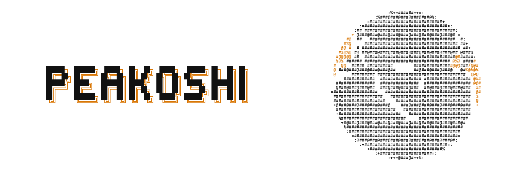

<picture>
  <source media="(prefers-color-scheme: dark)" srcset="assets/header-dark.png">
  <source media="(prefers-color-scheme: light)" srcset="assets/header-light.png">
  
</picture>

<pre>
<b>open source</b>
  <a href="https://github.com/peakoshi/ldr-flip">ldr-flip</a>             perceptual LDR FLIP image comparison in pure Rust
  <a href="https://github.com/peakoshi/mapsample">mapsample</a>            Windows x64 stack sampler, stall recorder, /MAP tool
  <a href="https://github.com/peakoshi/atrac9">atrac9</a>               safe, allocation-free ATRAC9 audio decoder in Rust
  <a href="https://github.com/peakoshi/shortroom">shortroom</a>            short-code P2P QUIC rooms over iroh in Rust
  <a href="https://github.com/peakoshi/amd-pm4">amd-pm4</a>              AMD gfx7 PM4 command-stream framing and state in Rust
  <a href="https://github.com/peakoshi/civil3d-ai-starter">civil3d-ai-starter</a>   describe a Civil 3D command, an agent builds it

<b>upstream</b>
  <a href="https://github.com/odysseus-dev/odysseus/pulls?q=is%3Apr+author%3Apeakoshi">odysseus</a>             2 merged fixes (email port validation, test isolation)
  <a href="https://github.com/NousResearch/hermes-agent/pulls?q=is%3Apr+author%3Apeakoshi">hermes-agent</a>         4 open fixes (backups, curator rollback, SSH, batch)

<b>archived</b>
  <a href="https://github.com/peakoshi/enfold">enfold</a>               local shared memory for AI agents (SQLite + MCP)
  <a href="https://github.com/peakoshi/enkeep">enkeep</a>               browser Markdown editor over plain files + MCP

<b>elsewhere</b>
  <a href="https://x.com/peakoshi">x.com/peakoshi</a>
  <a href="https://crates.io/users/peakoshi">crates.io/users/peakoshi</a>
</pre>
